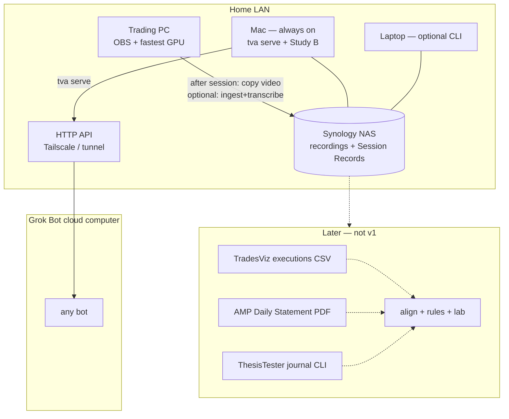

# 04 — Architecture (high level)

No code yet. This fixes the shape: where things run, what flows between
machines, what the contracts are, and how the bots consume the API.

---

## 1. Shape in one picture



The NAS is the shared disk. The Mac is the default API host. The trading PC
is the default *processing* host. Grok never sees the raw video.

---

## 2. Where does it run? (locked — D1, D3, D9)

| Machine | Role | Why |
|---|---|---|
| **Trading PC** | Record locally. After OBS stops: copy the Hybrid MP4 to the NAS. Prefer running ingest + transcribe here (fastest GPU). | Videos are born here. Do **not** record OBS directly onto SMB. |
| **Mac** | Always-on. Default `tva serve`. Can run the pipeline if the PC did not (hosted ASR fallback if there is no GPU). Hosts ThesisTester Study B today; disk is already tight — that is why the NAS exists. | Bots need a process that is up in the evening. |
| **Laptop** | Same CLI, same `TVA_ROOT` on the NAS mount. Ad-hoc / travel. | One codebase, path-configured. |
| **Synology NAS** | Source of truth for recordings and Session Records. Not a compute node. | See §2.1. |
| **Grok cloud computer** | HTTP client only. | Cannot mount the NAS. |

This is still topology **T1** (edge-heavy): media stays on the LAN; only
JSON (and, if a bot asks, a small clip) leave via the API.

### 2.1 Synology as the store — yes, with four rules

A home NAS is the right answer to "how do three machines and a future
private cloud share the tapes." It is a better D3 than Google Drive for
multi-GB video.

1. **Record local, copy after.** OBS Hybrid MP4 onto a Synology share drops
   frames and makes crash-recovery less useful. Trading PC SSD → post-session
   copy to `TVA_ROOT/recordings/` (never record OBS onto the NAS). A 20–40 GB
   file wants wired Ethernet (2.5G/10G if you have it); Wi-Fi copies will
   still be running when the evening bot fires. `tva watch --source <obs dir>`
   does the copy (`.part` + `recordings/<name>.lock`, never deletes the
   source). Desk wiring:
   [`scripts/windows/tva-watch.xml`](../scripts/windows/tva-watch.xml)
   (Task Scheduler),
   [`scripts/windows/copy-after-obs.ps1`](../scripts/windows/copy-after-obs.ps1)
   (one-shot),
   [`scripts/mac/com.tva.watch.plist`](../scripts/mac/com.tva.watch.plist)
   (launchd).
   Those templates are **nicht für ALTrading (B.5)**. This package never
   registers a task and never starts TVA / `tva-watch` at boot or login.
   `tva doctor` reports a registered `tva-watch` task via read-only
   `schtasks /Query` (list argv; skipped off Windows). On ALTrading run
   `doctor` only after trading. Accumu disables a registered task by
   hand (D7). Doctor never deletes or changes a task.
   Under `TVA_SIDECAR` (default off; PR-39) `watch` / `ingest` also copy
   exactly `<stem>.jsonl` next to the recording — not `.events.jsonl`.
   Events report `sidecar: ok|missing|invalid_json` and the watch report
   counts those. Destination is `$TVA_ROOT/recordings/<stem>.jsonl` from
   `--root` / `TVA_ROOT`, never a hardcoded NAS path. Flag unset is the
   old copy (video only).
2. **One env var, same layout everywhere.** `TVA_ROOT=/Volumes/tradevid` or
   `Z:\tradevid` (D8: there is no T: drive; Z: is the SMB share
   `\\AHORNBUSINESS\trading` — operator-set, never hardcoded as a
   sidecar dest). Layout:
   `recordings/`, `sessions/<id>/`, `fixtures/`. The API and the CLI both
   take `--root` / `TVA_ROOT`.
3. **Snapshots, not just RAID.** The tapes are irreplaceable. Synology
   Btrfs snapshots + a second-destination Hyper Backup (USB or offsite)
   beat a bigger volume.
4. **The NAS does not make the cloud bot local.** Grok still needs a
   reachability path to `tva serve` on the Mac: **Tailscale** (Synology has
   an official package; the Mac can also advertise the subnet) or a
   **Cloudflare tunnel**. No public port-forward of the API. The bot stores
   a Tailscale/Funnel URL, not a `192.168.x` address.

Until the NAS is on the desk, a folder on the Mac is a fine `TVA_ROOT`.
The app must not care.

### 2.2 Secrets

xAI (extraction) and any hosted ASR key live in the OS keychain /
environment on the machine that calls out. Never in a world-readable NAS
share. The bot's existing first-line password-file convention is acceptable
on the bot box only if the app never logs or echoes them.

No broker API keys in v1.

---

## 3. Pipeline stages and surfaces

Every stage is a CLI subcommand, idempotent, writing into
`$TVA_ROOT/sessions/<id>/`. The API exposes the same artifacts.

| Stage | CLI | API (sketch) | Output | v1? |
|---|---|---|---|---|
| Register | `tva ingest <video.mp4>` | `POST /sessions` (path on NAS) | `session.json`, `audio/mic.opus` | yes |
| Transcribe | `tva transcribe <session>` | (kicked by `POST /sessions/{id}/run`) | `transcript.json` | yes |
| Extract | `tva extract <session>` | same | `insights.json` (cited) | yes |
| Frames | `tva frames <session> [--at t…] [--contact-sheet]` | CLI (keyframes stay on `TVA_ROOT`; not a bot media route) | `frames/<t>.jpg` + optional contact sheet | yes, optional |
| OCR | `tva ocr <session>` | CLI (not a bot run stage) | `ocr.parquet` (`t, roi, text, confidence, parsed`) | yes, optional |
| Clips | `tva clips <session> [--redact]` | CLI (`GET /clips/{name}` only if `TVA_SERVE_MEDIA=1`) | `clips/<t>.mp4`, mic only; masks on `--redact` | yes, optional |
| VLM | `tva vlm <session>` | CLI (not a bot run stage; off unless `TVA_VLM_PROVIDER`) | `visual_notes.json` + `insights.visual_notes` | yes, optional |
| Status | `tva status` | `GET /sessions`, `GET /sessions/latest` | stage states | yes |
| Read | — | `GET /sessions/{id}`, `/transcript`, `/insights` | JSON | yes |
| Doctor | `tva doctor` | `GET /health` | ffmpeg / GPU / keys / NAS mount / autostart | yes |
| Fills | `tva fills <session> --executions <csv> --venue topstepx\|amp` | CLI (not a bot run stage) | `fills.parquet` / `trades.parquet` | yes, optional |
| Align | `tva align <session> [--manual-offset s]` | CLI (not a bot run stage) | `session.alignment` (offset/drift/confidence/method/samples) | yes, optional |
| Evidence | `tva evidence <session>` | CLI (not a bot run stage) | `evidence.json` per-trade windows + cited stated fields | yes, optional |
| Rules | `tva rules <session>` | CLI (not a bot run stage) | `rules.json` scorecard from `trades.parquet` plus `evidence.json` / `insights.session_events` | yes, optional |
| Context | `tva context <session> [--lab-dir]` | CLI (not a bot run stage) | `context.json` briefs/DRC + lab join on `entry_fill_id` | yes, optional |
| Report | `tva report <session>` | CLI (not a bot run stage) | `debrief.md` / `debrief.json` facts + cited prose | yes, optional |
| Ledger | `tva ledger add` / `tva rollup --week [--month]` | `GET /ledger/summary?weeks=4` | `ledger/ledger.duckdb` + rollup Markdown | yes, optional |
| Publish | `tva publish <session> --notion` | CLI (off by default; not a bot run stage) | Trading Journal Session Debrief + *TVA runs* log line | yes, optional |
| Proposals | `tva proposals <session>` / `tva proposals confirm <id>` | CLI (not a bot run stage) | `intent_proposals.json` + `tradesviz_tags.csv` | yes, optional |
| Coach | `tva coach --weeks 4` | `GET /coach/latest` (not a bot run stage) | `coach/latest.json` + `coach/latest.md`; `ledger.experiments` | yes, optional |

`tva run --latest` is the scheduler entry on the PC. `tva serve` is the
Mac entry. Same package.

---

## 4. The Session Record (v1 contract sketch)

Versioned JSON. Illustrative, not final:

```yaml
session:
  id: 2026-09-11                 # trading session date, ETH 18:00 ET
  recording: {path, sha256, start_wallclock_vienna, duration_s, tracks: [mic], chapters: [{t, name}]}
  language: de                   # primary; segments may flip
  alignment:                     # PR-18; null until `tva align`
    offset_s: 1.8                # wall = video_t + start_wallclock + offset
    drift_s_per_h: 0.0
    confidence: 0.96             # 0–1; from residual MAD + sample count
    method: ocr_clock | filename | chapter_fill | manual | invalid
    samples: [{video_t, ocr_text, parsed_wallclock, residual_s}]

time_anchor:                     # PR-40; omit unless TVA_SIDECAR; schema_version "1"
  status: verified | partial | invalid | incomplete | no_sidecar | sidecar_mismatch
  method: sidecar | null         # M2: sidecar when verified/partial; null = legacy
  first_frame_offset_s           # Q-15 = B: wall_span − video_span (TT:439–440)
  first_frame_offset_source: measured | fixed
  offset_source: fallback        # only when measurement failed (never silent)
  sections: [{index, status: verified | segment_invalid, method, reason,
              wall_start, wall_end, video_s_start, video_s_end, resume_offset_s}]
  fills: [{fill_id, video_s | null, reason: segment_invalid?}]

transcript:
  provider: whisperx; model: large-v3; prompt_version: jargon-v1
  segments: [{id, t0, t1, lang, text, words: [{w, t0, t1, p}]}]

insights:                        # model-derived, every field cited or null
  bias_statements: [{seg, text, t}]
  playbooks_mentioned: [{seg, name}]
  stated_levels: [{seg, token}]  # ONH, dVWAP, … as spoken, not as lab truth
  stated_stops_targets: [{seg, raw_text}]  # raw speech, not parsed prices
  checkins: [{seg, t, text}]
  tilt_markers: [{seg, text}]
  brief_refs: [{seg, text}]
  observations: [{seg, text}]    # labelled interpretation
  gaps: [string]                 # what the extractor could not hear
  session_events: [{t, kind, seg, text}]
    # kind ∈ hourly_checkin|bias_statement|no_trade_zone|trade_zone|tilt|
    #         break|rule_mention|brief_ref|grok_ref
  summary_de: string             # labelled prose, ≤ 120 words
  summary_en: string
  visual_notes: [{text, t, frames_cited[], clip}]  # PR-15; default []
  # PR-08: provider/model/prompt_version; grok windows ≤40 / overlap 5
  # citation failures drop into gaps[] (unknown seg or fabricated quote)
  # PR-09: events from a second pass (ids + first-pass citation ids, no
  # transcript text; event text re-hydrated); summaries drop if they contain
  # a digit run that is not an exact digit run in any *valid* cited segment

evidence:                        # PR-19; omit until `tva evidence`
  provider / model / prompt_version
  trades: [{tva_trade_id, window{t0,t1, window_clipped+t0_raw+t1_raw only when clipped}, commentary[],
            stated{setup,bias,stop_raw,target_raw,playbook} each {value,seg}|null,
            markers[], frames[], ocr[], clip, alignment_confidence,
            alignment: low|null, gaps[]}]

fills: null                      # later
trades: null                     # later
rules:                           # PR-20/21; omit until `tva rules`
  [{rule: R-DLL|R-MAX10|R-3L30|R-5M|R-REENTRY|R-CLOSE|
           R-PLAYBOOK|R-DEFINED|R-3C-CT|R-ARRIVAL|R-SLTP|
           R-HOURLY|R-ZONE|R-BIAS|R-TILT,
    status: pass|violated|unverifiable, evidence{…}, reason?}]
  # thresholds in rules.yaml; daily_loss_limit_usd / flat_by null → unverifiable
  # deterministic rows: trades.parquet only; never the model
  # evidence-backed rows: evidence.json + session_events; absent speech →
  # unverifiable (never pass). R-SLTP always unverifiable (no order mods)
  # evidence-backed pass always cites a segment id
context:                         # PR-22; omit until `tva context`
  brief: {macro_url, ny_url, bias_nq, bias_es, conviction, kill_levels, quoted: true} | null
  drc: {scores, url} | null
  lab: {per_trade: {T01: {nearest_level_token, level_context, tag_alignment,
        inferred_triggers_1m, zone_id}}} | null
  gaps: []
  # Notion fake by default; live needs NOTION_API_KEY. Lab parquet is read-only.
debrief:                         # PR-23; omit until `tva report`
  md / json, fixed section order: source · day · trades · rules ·
  brief vs behaviour · observations · learnings · gaps
  # facts from files; prose via ReportProvider (fake default, grok opt-in)
  # every digit run in debrief.md is in trades.parquet / ocr.parquet / context.json
ledger:                          # PR-24; omit until `tva ledger add`
  duckdb tables: sessions, trades, rule_checks, events
  # DuckDB reads trades.parquet; add is idempotent
  # rollup: adherence, violations, trades/hour, stated-vs-lab
publish:                         # PR-25; omit until `tva publish --notion`
  page_id / url / title / Summaries / Learning 1–3
  # off without --notion; fake Notion default; update in place
proposals:                       # PR-26; omit until `tva proposals`
  [{tva_trade_id, proposed_tags[], source_segs[], status: proposed|confirmed|rejected}]
  # desk keys from ThesisTester tag_map.yaml only; unknown spoken words dropped
  # tradesviz_tags.csv: date, symbol, side, price, quantity, tags, notes
  # notes prefixed [TVA proposed]; confirm toggles proposed ↔ confirmed
coach:                           # PR-27; omit until `tva coach`
  claims: [{text, cites[], question}]   # each cites ≥ N ledger row ids
  experiment: {rule_change, start, stop_criterion, status} | null
  # N from TVA_COACH_MIN_N (default 10); ≤ 1 experiment
  # fake default; grok opt-in (XAI_API_KEY)

provenance: {app_version, ffmpeg, models, created_at}
```

Hard rules: every model-derived field has a sibling reference; every number
that is not later supplied by fills or OCR is `null` or raw quoted text,
never estimated.

PR-08 extractor: `tva extract --provider grok` (`XAI_API_KEY`, optional
`TVA_EXTRACT_MODEL`). System prompt is `prompts/insights_v1.de.md`;
`prompt_version` is `{stem}+{sha256[:12]}`. Fake keyword scan is explicit
opt-in (`TVA_EXTRACT_PROVIDER=fake` or `--provider fake`); unset aborts
(`TVA_EXTRACT_PROVIDER fehlt`, PR-43).

PR-43: no silent provider fallbacks. Unset ASR / OCR / extract fails
loudly (`TVA_*_PROVIDER fehlt`). `tva serve` `POST /sessions/{id}/run`
returns 400 with that message, never placeholder transcript/insights.
Media extract failure stamps session status `audio=failed` /
`audio_failed: …` instead of swallowing `MediaError`. Evidence windows
that were clipped to the clip set `window_clipped: true` plus the
original bounds. Day publication refuses facts stamped `provider: fake`.

PR-09: additive `session_events` / `summary_de` / `summary_en` on the same
`schema_version: "1"`. Grok’s second pass uses `prompts/events_v1.de.md`
and the closed `kind` set above. The citation guard covers events and
rejects summaries whose digit runs are not exact runs in a valid cited
segment (`summary_de` also capped at 120 words).

PR-40: under `TVA_SIDECAR` (default off) `sidecar.py` reads `<stem>.jsonl`
and writes `sessions/<id>/time_anchor.json`. Pause rule R13 (media time
continues at pause `video_s`; resume band 0.4–0.8 s). N5 per-section
judgment. Q-15 = B: first-frame offset is measured per clip as
`wall_span − video_span` (TT:439–440): `record_stop`−`record_start`
wall minus pause spans, minus ffprobe duration. `start_time` below
0.1 s is unusable. 1.043 s is a loud fallback (`offset_source: fallback`
plus a warning on every clip). Corrupt JSONL is `invalid` /
`invalid_json` (legacy path). File name + duration ±0.1 s vs ffprobe,
else `sidecar_mismatch`. Flag off does not write the file and leaves
alignment unchanged. With `TVA_PAUSE_GUARD`, a verified/partial sidecar
replaces the detector (`pause_checks.method = sidecar`); a leftover OCR
check is not reused.

PR-15: additive `visual_notes` on the same `schema_version: "1"` (default
`[]`). `tva vlm` is off unless `TVA_VLM_PROVIDER` is set. Grok sends
redacted JPEG `image_url`s (official docs.x.ai image understanding —
Imagine `video_url` is generation-only). Gemini uses the File API for a
redacted clip. The number guard drops a note whose digit runs are not in
`ocr.parquet`. Cost is accumulated on `status.cost_usd`. Not a
`POST /run` stage.

---

## 5. Relationship to ThesisTester and the journal

PR-16 consumes ThesisTester; it does not fork it.

- **TradesViz executions CSV** is the broker-agnostic fill clock (TopstepX
  and AMP already land there). `tva fills` calls
  `thesistester.journal.tradesviz.load_tradesviz_executions` +
  `pair.pair_journal_trades` when `tradevidanalyser[journal]` is
  installed; otherwise `fills_mirror.py` (contract-tested against
  fixtures generated by those functions). TVA adds `venue` and
  `tva_trade_id` only. `commission` / `fees` stay discarded (TJ1).
  Under `TVA_NET_FEES` (Vierer-Set only) the fills path reads a TT
  journal directory (`journal_trades.parquet`,
  `journal_lot_sources.parquet`, positions, `week_manifest.json`).
  Costs, net, and `account` come from those artifacts (JX1/TJ4
  already applied). Account is taken from `journal_lot_sources` or
  `trade_id` `tx:{account}:{Id}` and checked against `--account`.
  Positions come from an explicit `--positions-dir`
  (`journal_positions.parquet`); without it the fallback is
  `build_journal_positions`. A TradesViz CSV under the flag is
  `Netto ohne Kostenquelle`.
  Publish follows TT `report.py:654-657`: `validate_week_manifest`,
  `assert_manifest_inputs_match`, `assert_claimed_lock_supported`,
  then `lock_status == locked` with matching week and account.
  The week file is written by `lock_files` (a tick `prepare_manifest`
  is required). Hashed inputs are TT `inputs: [{role, path, sha256}]`
  mapped to resolved files (`reconcile`, `journal_trades`,
  `journal_lot_sources`, `journal_positions`, `positions_json`,
  `prepare_manifest`, `ticks`, `accounts`). A hand-edited `locked`
  (`lock_status_inconsistent`) or a tampered hash (`input hash
  mismatch`) cannot unlock.
  Desk rules: TT-shaped synthetic `accounts.yaml` (per-instrument
  `fee_schedule`, explicit `trading_days` dates) plus TVA
  `desk_rules.yaml` (account → desk). Topstep rules never apply to
  other accounts.
  Missing account under the flag is `Konto fehlt`. R-MAX10 under
  the flag counts JX2 positions, or lots with `count_basis: lots`
  when none are present. Independent recomputation stays with the
  coach (R8 / PR-46).
- **AMP recon passthrough (PR-17):** `tva fills --reconcile-dir` reads
  ThesisTester `reconcile.json` and stamps `recon_status` on each trade
  by `session_date` (+ instrument). TVA does not parse AMP PDFs.
- **AMP Daily Statement PDF** is FCM money truth (fees, P&S). ThesisTester
  already owns `amp_statement`. Use it; do not re-parse the PDF.
- **ThesisTester** `journal attribute|zones|triggers` supplies level tokens
  and inferred triggers. `tva context --lab-dir` reads
  `journal_attribution.parquet` / `journal_zones.parquet` /
  `journal_triggers.parquet` (also the short `attribution.parquet` /
  `zones.parquet` / `triggers.parquet` names) and joins on
  `entry_fill_id`. TradeVidAnalyser never computes levels.
- Spoken setup names become *proposed* TradesViz tags (`proposed` until a
  human confirms). `tva proposals` maps `stated.playbook` /
  `stated_levels` onto ThesisTester `tag_map.yaml` desk keys (never
  invented tags, never engine tokens). Tags stay intent, not evidence.
- **Debrief (PR-23):** `tva report` reads `context.json`, `trades.parquet`,
  `rules.json`, and `evidence.json`. Facts are rendered from those files.
  Prose must cite ids. ThesisTester levels are never recomputed.
- **Ledger (PR-24):** `tva ledger add` copies one session into
  `ledger/ledger.duckdb`. Trades come from `read_parquet`. Stated-vs-lab
  compares `evidence.stated` to `context.lab` tokens (no level math).
- **Publish (PR-25):** `tva publish --notion` writes one Trading Journal
  page (`<D Mon YYYY> Session Debrief`, tag *Trades Summary*) and one
  *TVA runs* log line. Idempotent update in place. Off by default.
- **Coach (PR-27):** `tva coach --weeks 4` reads ledger rows plus the
  last N debriefs. Each claim must cite ≥ N ledger row ids. At most one
  experiment `{rule_change, start, stop_criterion}` is appended to
  `ledger.experiments`. Fake provider default; Grok is opt-in.

Good reasons to do that join *eventually*:

- Speech alone is "he said ONH." Speech + fill is "he said ONH and filled
  eight seconds later four ticks through." That is the coaching that
  changes behaviour.
- Speech + lab is "he named the scalp playbook at a location the study
  says is a coin flip." Edge Finder can use that.
- TradesViz already solved "I trade more than one venue." We should not
  undo that by growing a TopstepX client as the spine.

Good reasons **not** to do it in v1: it delays the only thing that does
not exist today (tape → structured German transcript → Grok), and it
couples the first useful API to a second repo and a journal export ritual.

---

## 6. Bot integration (v1)

- **Any Grok bot**, on demand or as an evening routine: `GET /health`,
  then `GET /sessions/latest`. Evening only proceeds when `session.id`
  starts with **today’s** Europe/Vienna date. If `insights` is present,
  write the bot's own Notion note. If a stage is `missing` or `failed`,
  ping. 23:30 watchdog unless *TVA runs* already has `status ok` for
  today’s session id (a today-dated line for yesterday does not count).
- **Hard rules:** never edit `insights.json` / `transcript.json`; never
  invent a quote; every quoted line must exist in `transcript.json`; never
  treat a spoken price as a fill; never call anything but the API.
- **Reachability:** Tailscale URL or Cloudflare tunnel to the Mac, stored
  like any other bot secret. Not a LAN IP. `tva serve` may bind loopback
  without a token. Binding off-loopback (Tailscale IP, `0.0.0.0`) requires
  `TVA_API_TOKEN`; the process refuses to start without it. Clients send
  `Authorization: Bearer …`. Clips stay off unless `TVA_SERVE_MEDIA=1`.
- Sunday audit (Question Bot): `GET /sessions?days=7` + `/health`.
- `tva report` is CLI-only and is not a `POST /run` stage. The bot pack
  still writes its Notion note from insights; it does not fetch
  `debrief.md`.
- `GET /ledger/summary?weeks=4` is the ledger read. `tva ledger add` /
  `tva rollup` stay CLI. Not a `POST /run` stage.
- `tva publish --notion` is CLI-only, off by default. The bot may keep
  writing its own Notion note from insights.
- `tva proposals` / `tva proposals confirm` are CLI-only. Not a
  `POST /run` stage. The bot does not import TradesViz tags.
- `GET /coach/latest` is the coach read. `tva coach --weeks 4` stays
  CLI. Not a `POST /run` stage. 404 means the review has not been
  written.

Copy-ready pack: [`TVA_GROK_ROUTINE_PACK.md`](TVA_GROK_ROUTINE_PACK.md)
and [`examples/bot/`](../examples/bot/). Paste `SYSTEM.md` as the bot
system prompt; schedule evening + Sunday + 23:30 Vienna watchdog.

A dedicated "TradeVid bot" is optional. v1 is useful to the bots that
already exist.

---

## 7. Quality gates (engineering)

- Golden session: one redacted real-session excerpt (German commentary,
  20–30 min) in a *private* fixtures location (NAS, not this public-ish
  repo). Hand-corrected transcript for WER.
- `ruff` + `pytest` in CI. Provider adapters with a `fake` implementation.
- No ThesisTester import in the v1 package metadata.
- API contract tests against committed example JSON (no video in CI).
